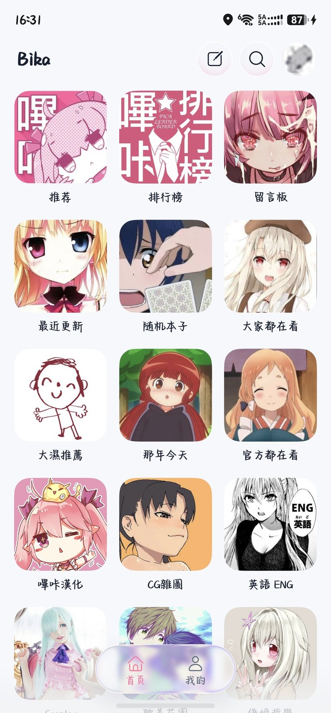
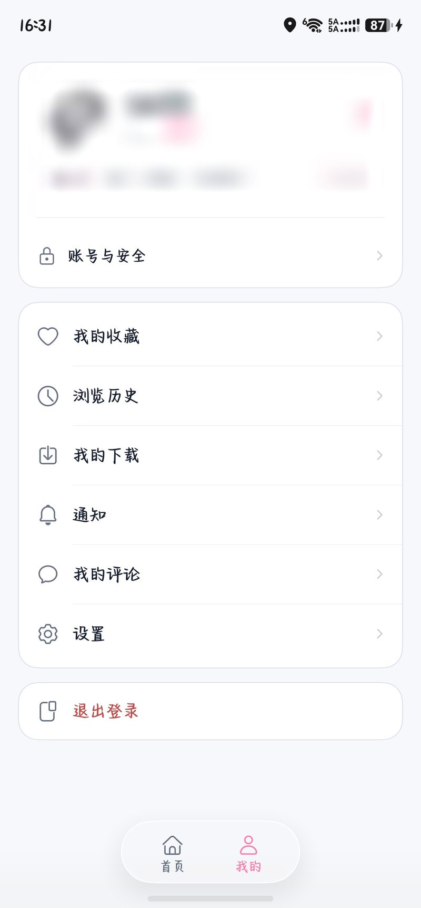
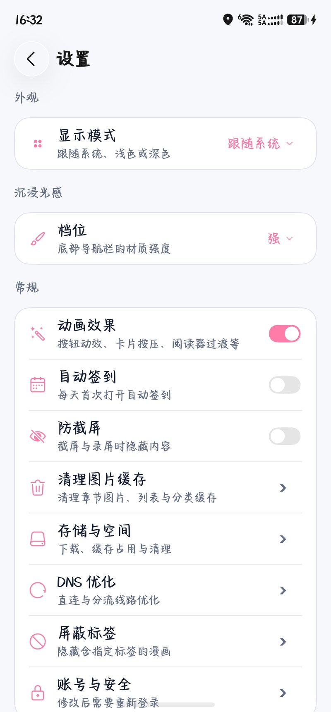
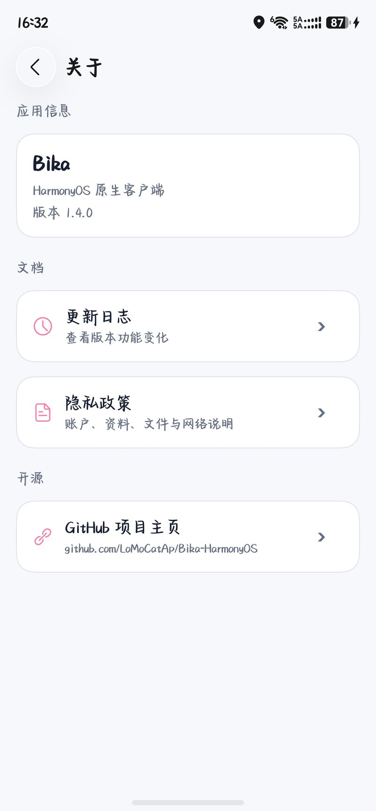

# Bika HarmonyOS

[简体中文](README.md) · **English**

<p align="center">
  
  
  
  
</p>

## Disclaimer

This repository is for learning and discussion. If you believe any content infringes your rights, please open an issue so we can remove it promptly.

## About

Bika HarmonyOS is a third-party Bika Comics client for HarmonyOS NEXT, built with native ArkTS and ArkUI.

I built this project to learn ArkTS and ArkUI. If you find it helpful, consider starring the repository.

## Contents

- [Disclaimer](#disclaimer)
- [About](#about)
- [Screenshots](#screenshots)
- [Release notes](#release-notes)
- [Features](#features) · [Reader](#reader)
- [Recent changes](#recent-changes)
- [Credits](#credits)
- [Build and run](#build-and-run)
- [Privacy and data](#privacy-and-data)
- [Project structure](#project-structure)
- [Feedback](#feedback)
- [License](#license)

## Screenshots

<p align="center">
  
  
  
  
</p>

<p align="center">
  <sub>Home channels · Profile · Settings · About</sub>
</p>

## Release notes

**v1.5.2 · Tablet Reading and Page Curl**

1. Added Auto, Single Page, and Double Page layouts to the reader.
2. Added a page-curl animation option for horizontal reading.
3. Swipe left or right anywhere in the reading area, or tap either side to turn pages. The reader now shows a message when you try to go past the first or last page of a chapter.
4. Reader settings are grouped into Reading and Display tabs. You can show the time and battery level when the reader controls are hidden.
5. Improved the feedback when favoriting or liking a comic on its details page.

This release targets **API 26**. Glass effects on toasts and system dialogs require **HarmonyOS 7.0.0 or later**.

Sign the HAP before installing it. To keep your login and local data when upgrading, use the same signing certificate as your current installation. 

[Download HAP](https://github.com/LoMoCatAp/Bika-HarmonyOS/releases/download/v1.5.2/Bika-HarmonyOS-1.5.2.hap) · [GitHub release](https://github.com/LoMoCatAp/Bika-HarmonyOS/releases/tag/v1.5.2)

In the app, open Settings → About → Changelog to see the version history.

## Features

### Account and profile

- Sign in with a username and password. System Asset Store Kit encrypts credentials and supports migration from older versions and automatic sign-in.
- Register with a username, nickname, password, and three security questions. The sign-in form fills in your username after registration.
- Edit your profile signature, change your password, or sign out. A password change requires signing in again.
- Check in daily. The app remembers whether you have already checked in.

### Home and channels

- Browse 45 channels, including recommendations, rankings, recent updates, random comics, and sections by theme, attribute, or franchise.
- Reorder or hide channels, or restore the default layout.
- Sort channel lists by newest, oldest, most likes, or most views.
- Filter by theme, excluded theme, completion status, chapter count, or page count.
- Sorting and filtering depend on the channel. Recommendations and On This Day use fixed lists. Popular With Everyone and Staff Picks use their default sort order.
- Browse daily, weekly, monthly, and Knight rankings.

### Comic details and interactions

- Browse the Details, Chapters, and Comments tabs, see related comics, and get immediate feedback when liking or favoriting a title.
- View details and chapter lists for downloaded comics offline. Opening an older download while online fills in missing information.
- Tap authors, tags, or categories to search. Read status is tracked per chapter, and newly added unread chapters show an update badge.
- Sort and paginate comments by newest, oldest, or most liked.
- Like, reply to, or post comments, and expand nested replies.
- Share a comic through the system share sheet.

### Reader

- Choose from five reading modes. The app remembers the last mode across comics and restarts.
- The top glass toolbar shows the chapter and title and provides download and settings controls. The bottom toolbar shows the page number and lets you switch chapters.
- Tap the page number to open the progress slider. The target page number updates while you drag, and releasing jumps to that page. The toolbar returns after a short pause.
- Download the current chapter, all chapters, or a range. The chapter picker supports selecting or clearing all chapters.
- Export the current chapter as a PDF or ZIP of images, with a choice of filename and destination.
- Lock portrait or landscape orientation, adjust brightness, and resume at the last page.
- Settings are grouped into Reading and Display tabs. Both scroll in landscape and small windows. Time and battery indicators can appear when the toolbars are hidden.
- Swipe either way across the reading area or tap either side to turn pages in horizontal mode. Choose between sliding and page-curl animations.
- Use the optional volume-key page controls and the page number indicator. Attempting to turn past either end of a chapter shows a message.
- Press and hold an image to drag it to SuperHub or another app.
- Choose Auto, Single Page, or Double Page layouts. The first image can appear on its own in Double Page mode, and vertical comic width is adjustable on large screens.

### Downloads and cache

- Configure Wi-Fi-only downloads and download concurrency, retry failures, read offline, and delete downloads by title.
- Save comic details and the complete chapter list. While offline, chapter navigation steps through downloaded chapters.
- The image loader uses a memory cache, a 200 MB disk LRU cache, and mirror fallback.

### Search

- Search by keyword, popular term, author keyword, tag, or category.
- Sort results, load more pages, retry failures, and skip duplicates. Cross-device app continuation preserves search criteria.
- View or clear search history.

### Settings and networking

- Choose a light, dark, or system theme and adjust the glass effect.
- One animation switch controls button feedback, card presses, image placeholders, and toolbar transitions.
- Configure automatic check-in, screenshot blocking, and tag exclusions for channels and search.
- Favorite updates are optional. Once enabled, the app checks for new chapters on launch or when it returns to the foreground and sends a system notification. The first check sets the baseline.
- View download and cache usage and clear stored images.
- DNS optimization loads route options, measures connection latency, and can select the fastest route automatically. Manual selection and reset are also available.
- System proxy support works with rule-based routing.
- Check for updates and open the download on GitHub Releases.
- The About page shows app information, change history, and the privacy policy.

### Layout and themes

- Light and dark themes have separate color resources.
- Channel grids and comic lists adapt to the available width, with up to six columns on tablets.
- Lists leave room for the system safe area and floating navigation bar.

## Recent changes

| Version | Highlights |
|---|---|
| **v1.5.2** | Auto, Single Page, and Double Page layouts, page curl, full-area gestures, and chapter boundary hints. Reader settings tabs and improved favorite and like feedback. |
| v1.5.1 | Fixed offline access to details and chapters. Saved comic metadata and chapter lists, and improved offline navigation and messages. |
| v1.5.0 | Favorite update notifications, chapter badges, metadata search, and secure credential migration. Reader and navigation fixes. |
| v1.4.7 | Glass effects across the app and refined page edges. |
| v1.4.6 | Glass reader controls, progress slider, and quick downloads. Fixed the settings panel during orientation changes and refined tablet sheets and page edges. |
| v1.4.5 | Fixed reading mode persistence and right-to-left paging. Mode changes preserve the current page. |
| v1.4.3 | Fixed garbled Chinese filenames in ZIP exports. |
| v1.4.2 | Added app continuation, background downloads, and download notifications. Fixed live download progress and Wi-Fi-only scheduling. |
| v1.4.1 | Fixed dialog border and background colors and missing loading indicators for channel lists and comments. |
| v1.4.0 | Sign-in prompts, home pull-to-refresh, and unified registration styling. Fixed the login-state flash on launch, dark dialog backgrounds, and widget refresh and cover issues. |
| v1.3.8 | Glass title bars across 12 Profile subpages and five new home screen widgets. |
| v1.3.7 | Targeted API 26 and added glass effects to toasts and system dialogs. |
| v1.3.6 | Returned page cards to the standard list style after an API change and adjusted the sign-out text color. |
| v1.3.5 | Fixed category list parsing and used the latest comics feed for Recommendations. Matched channel controls to API capabilities. |
| v1.3.4 | Added retry and empty states for categories, bottom spacing for Home and Favorites, and a fallback when related comics are unavailable. |
| v1.3.3 | Adaptive tablet grids and centered, width-limited reader content. |
| v1.3.2 | Fixed the changelog and privacy dialogs and applied glass effect adjustments immediately. |
| v1.3.1 | Global animation switch, immediate glass effect adjustments, and rule-based system proxy support. Fixed download deletion. |
| v1.3.0 | Comment sorting and pagination, system sharing, volume-key paging, disk cache, image dragging, and PDF and ZIP exports. |

## Credits

- [shizq123/BIKA](https://github.com/shizq123/BIKA) is the Android Bika client that informed the feature set and interactions.
- [raoxwup/haka_comic](https://github.com/raoxwup/haka_comic) provided a reference for request signing and image mirror routing.
- [YuanChu-Tec/JMComic-HarmonyOS](https://github.com/YuanChu-Tec/JMComic-HarmonyOS) provided a reference for HarmonyOS reader structure and use.
- Bika's official services and domestic mirrors provide the API and images.

## Build and run

1. Install DevEco Studio and HarmonyOS SDK API 26 or later through SDK Manager.
2. Copy `build-profile.json5.example` to `build-profile.json5` and configure your signing materials in DevEco Studio.
3. Open the project root in DevEco Studio, select the `entry` module and a connected device or emulator, and run the app.

You can also build from PowerShell.

```powershell
$env:DEVECO_SDK_HOME = 'C:\Program Files\Huawei\DevEco Studio\sdk'
node 'C:\Program Files\Huawei\DevEco Studio\tools\hvigor\bin\hvigorw.js' --mode module -p product=default -p buildMode=debug assembleHap --no-daemon
```

Find the built HAP in `entry/build/default/outputs/default/`.

To install and launch the app on a connected device, run the following commands.

```powershell
hdc install -r entry\build\default\outputs\default\entry-default-signed.hap
hdc shell aa start -a EntryAbility -b com.lomocat.bika
```

## Privacy and data

- System Asset Store Kit encrypts the sign-in password and token on the device for automatic sign-in and Bika API access. Upgrades verify the migration and preserve reading history and settings.
- Bika's servers provide profile details such as avatars, nicknames, and levels. The app does not collect or upload them separately.
- Downloaded comics and cached images are stored in the app sandbox. Uninstalling the app removes that data.
- Comic requests go to Bika's official endpoints and domestic mirrors. The app includes no third-party analytics.

See About → Privacy Policy in the app for details.

## Project structure

```text
AppScope/                           App configuration and icons
entry/src/main/ets/
  entryability/                     App entry, window setup, theme, and settings restoration
  entrybackupability/               Backup extension
  common/                           Constants, caching, downloads, image loading, export, and material compatibility
  components/                       Reusable ArkUI components such as comic cards and network images
  features/                         Home, downloads, and profile modules
  models/                           Domain models and view models
  network/                          Request signing, direct routing, DNS, and API services
  pages/                            Home entry, channels, details, reader, search, sign-in, and registration
entry/src/main/resources/           Strings, light and dark colors, and theme resources
```

## Feedback

- [Project repository](https://github.com/LoMoCatAp/Bika-HarmonyOS)
- [GitHub Issues](https://github.com/LoMoCatAp/Bika-HarmonyOS/issues)

## License

This project is licensed under the [GNU General Public License v3.0](LICENSE).
